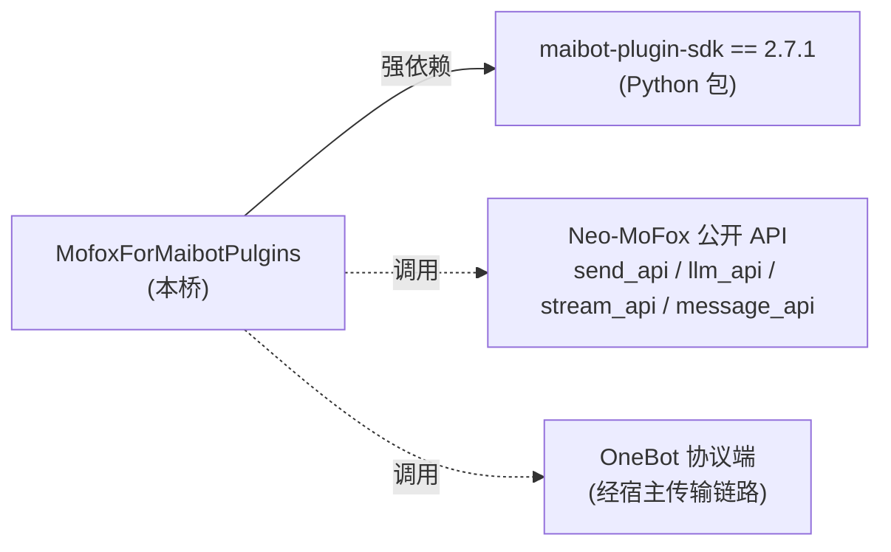
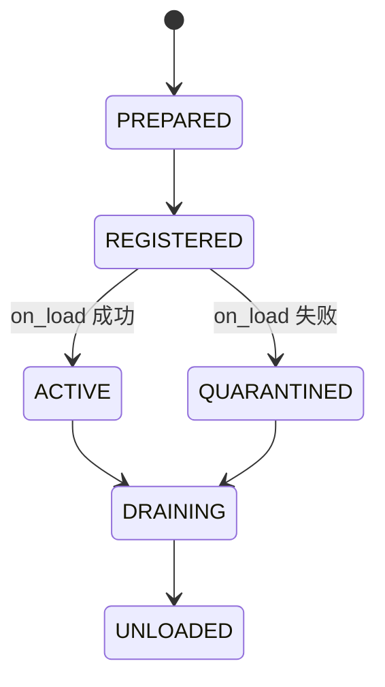

# MaiBot 官方 SDK 兼容桥

`MofoxForMaibotPulgins` 在 Neo-MoFox 内加载**可信的** MaiBot 插件，并且只接受官方
`maibot-plugin-sdk==2.7.1`。它不是 import shim，也不会把未映射能力伪装为成功。

> 本桥只加载可信插件，外部代码与宿主同进程执行，**不构成沙箱**。

---

## 前置依赖

本桥**不依赖任何其它 Neo-MoFox 插件**，但强依赖官方 Python 包 `maibot-plugin-sdk`
的固定版本 `2.7.1`。该包未安装或版本不满足时，桥会在准入阶段直接拒绝激活。

### 依赖链



### 在 manifest 中的声明

`manifest.json` 通过 `python_dependencies` 声明对 `maibot-plugin-sdk` 的固定版本依赖：

| 层级 | 字段 | 值 | 作用 |
| --- | --- | --- | --- |
| 插件级 | `dependencies.plugins` | `[]` | 无前置 Neo-MoFox 插件依赖 |
| 插件级 | `dependencies.components` | `[]` | 无前置组件依赖 |
| Python 包 | `python_dependencies` | `["maibot-plugin-sdk==2.7.1"]` | 主程序启动时由 `bot.py` 统一安装；`dependencies_required=true` 时安装失败则整桥不加载 |

> `python_dependencies` 使用 pip requirement 格式，由
> `src/app/runtime/bot.py` 在加载前通过 `pip install` 统一安装；
> `dependencies_required=true` 表示安装失败时从加载队列移除并记录，而非保留半初始化状态。

### 需要自行安装的 Python 包

`maibot-plugin-sdk==2.7.1` 已在 manifest 中声明，主程序会自动安装。
若在离线环境，请预先执行：

```bash
uv pip install "maibot-plugin-sdk==2.7.1"
```

---

## 快速开始

### 1. 确认前置条件

- `maibot-plugin-sdk==2.7.1` 已安装（主程序启动时由 `bot.py` 自动安装，离线环境需手动 `uv pip install "maibot-plugin-sdk==2.7.1"`）；
- 桥本身在 WebUI → 插件管理页显示为已加载（`MofoxForMaibotPulgins v0.1.2`）；
- 若外部插件需要发送消息，OneBot 协议端应已连接（桥通过宿主 `send_api` 发送）。

### 2. 放入 MaiBot 插件

将待加载的 MaiBot 插件目录放入本桥的 `plugins/` 子目录，每个子目录必须包含 `plugin.py`：

```text
plugins/MofoxForMaibotPulgins/plugins/
└── wife_plugin/             # 示例：已内置
    ├── plugin.py            # 入口，必须存在
    └── _manifest.json       # 可选，声明插件元信息与 Python 依赖
```

也可在 WebUI → 插件配置 → `MofoxForMaibotPulgins` 中修改：

| 配置项 | 作用 |
| --- | --- |
| `plugin.enabled` | 是否启用兼容桥，关闭后整桥不激活 |
| `plugin.plugins_root` | 扫描根目录，每个子目录作为一个单元加载；留空则默认为桥同级 `plugins/` |
| `plugin.plugin_path` | 只加载指定单个插件目录；留空则批量扫描 `plugins_root` |
| `plugin.unload_timeout_seconds` | 卸载时 drain 与 `on_unload()` 的最大等待秒数 |

### 3. 配置外部插件（按需）

外部插件的配置通过官方 `set_plugin_config()` 注入。若插件声明了 `_manifest.json` 中的 Python 依赖，桥只接受**已安装且满足版本约束**的包，绝不在运行期隐式安装。标准路径会递归检查插件目录内所有 Python 源码并拒绝 YesMai 依赖或导入。

### 4. 重载桥使配置生效

在 WebUI → 插件管理页找到 `MofoxForMaibotPulgins`，点击「重载」。重载会重新扫描 `plugins/`、执行各单元 `on_load()`，失败单元会被隔离（`QUARANTINED`）但不影响其他单元。

### 5. 验证

- WebUI → 插件管理 → `MofoxForMaibotPulgins` 详情页，`组件` 列表应包含 `event_handler:maibot_plugin_bridge` 及桥为外部插件生成的 `tool:maibot__{slug}__{name}`；
- 在 QQ 群/私聊中触发外部插件注册的 `@Command` 或 `@Tool`，观察是否正常响应；
- 外部插件调用 `ctx.send.text()` / `ctx.send.image()` 时，消息经宿主 `send_api` 发送到来源 `stream_id`。

### 故障排查

| 现象 | 排查方向 |
| --- | --- |
| 桥未加载 | 查看主程序日志 `deps_installer` 段，确认 `maibot-plugin-sdk==2.7.1` 安装成功；`dependencies_required=true` 时安装失败会移出加载队列 |
| 外部单元被隔离 | 查看日志中 `maibot_plugin_bridge` 的准入失败原因：缺少 `plugin.py`、`on_load()` 抛异常、声明了被拒绝的 capability（如 `@MessageGateway`）、YesMai 依赖等 |
| LLM 调用失败 | `ctx.llm.generate()` 必须显式指定 `task` 或 `model`，不会回退默认；确认对应任务/模型在 Neo-MoFox 中可用 |
| 调用被拒绝的能力 | 参见下方「明确拒绝的能力」章节，如 `send.hybrid`、`render.html2png`、`@LLMProvider` 等无映射的能力会返回稳定错误 |

---

## 外部插件位置

将待加载的 MaiBot 插件放在桥的 `plugins/` 子目录；每个子目录是一个独立单元，至少包含
`plugin.py`，并可包含 `_manifest.json`：

```text
MofoxForMaibotPulgins/
├── plugin.py                 # 兼容桥
└── plugins/
    ├── avatar_fetcher/
    │   ├── plugin.py
    │   └── _manifest.json
    └── another_plugin/
    └── plugin.py
```

也可通过桥配置指定单个插件目录或扫描根目录。只加载来源可信的 Python 插件；该桥不是安全沙箱。

## 已实现的受限映射

| 官方 SDK 声明 / capability | Neo-MoFox 映射 |
| --- | --- |
| `@Command` | 一个桥事件处理器内按 pattern / aliases 分派；官方三元返回的阻断位会生效。 |
| `@EventHandler(ON_MESSAGE)` | 按 `weight` 降序、同权稳定顺序派发；只能替换既有 `message` 参数。 |
| `@Tool` | 在宿主组件快照前生成 `maibot__{slug}__{name}` 形式的 `BaseTool`。 |
| 官方兼容 `@Action` | SDK 2.7.1 将其作为 Tool 声明处理，映射为同样的 `BaseTool`，**不会**创建 `BaseAction`。 |
| `@API` / 动态 API | 仅在本桥 realm 内以 `(plugin_id, name, version)` 路由，替换原子化；卸载后不可调用。 |
| `ctx.send.text()` | 经公开 `send_api.send_message()` 发送，保留来源 `stream_id`、平台、回复和群/私聊目标。 |
| `ctx.send.image()` / `ctx.send.emoji()` | 使用真实 `MessageType.IMAGE` / `MessageType.EMOJI` 发送；不可表达的输入会失败。 |
| 入站 `message` payload | 保留宿主 plain text、已知 OneBot 段、媒体、协议未知段与宿主未知段；归一化不修改原始 `raw_data`。 |
| `ctx.config.*` | 读取经过官方 `set_plugin_config()` 注入的当前单元配置。 |
| `ctx.llm.generate()` | 必须显式指定 `task` **或** `model`；分别调用公开任务/模型解析 API，支持 `temperature`、正整数 `max_tokens`，保留 reasoning 和 ToolCall，并传播底层失败。 |
| `on_load()` / `on_unload()` / `on_config_update()` | 依照单元状态机调用；激活失败仅隔离该单元。 |

## 明确拒绝的能力

以下能力当前没有无损、公开的 Neo-MoFox 映射；调用或声明会获得稳定错误，而不是空值、文本降级或伪成功：

- `@MessageGateway`、`@LLMProvider`、`@HomeCard`、`@HookHandler`、`WorkflowStep`；
- 不是 `ON_MESSAGE` 的 `@EventHandler`；
- `send.hybrid`、`send.forward`、`send.command`、`send.custom`；
- `render.html2png` 及未列入桥 capability 映射的能力；
- YesMai 或 `com.yesmai.*` 路径；
- 宿主组件快照完成后才声明的新 Tool。

官方 SDK 2.7.1 没有公开的受管后台任务 capability。桥内部任务会使用
`TaskManager` 跟踪和 drain，但不会伪造 `ctx.register_task()` 或声称第三方插件可通过
官方 `PluginContext` 取得该能力。

外部插件缺少 `on_load()`、`on_unload()` 或 `on_config_update()` 的真实覆盖实现，也会在准入阶段失败。

外部 `_manifest.json` 若声明 Python 依赖，桥只接受已安装且满足 `>=`、`==` 等版本约束的
字符串或 `python_package` 结构化声明，绝不在运行期隐式安装。标准路径会递归检查插件目录内
所有 Python 源码并拒绝 YesMai 依赖或导入；`llm.generate` 必须显式给出 `task` 或 `model`，
不会回退到默认模型任务。

## 生命周期和隔离

每个外部单元遵循：



卸载时先停止新调用并移除 API 路由，随后取消并有界等待桥受管任务与活动调用，执行
`on_unload()`，最后清理外部模块前缀。一个单元失败不会让已激活的其他单元停止工作。

## 配置和名称迁移

- 外部配置通过官方 `set_plugin_config()` 注入，更新失败会回滚到旧快照。
- 当前不宣称支持外部插件结构化 WebUI 配置持久化；没有公开宿主 API 时不会写入私有配置状态。
- 启动时会尝试将旧错误名称 `EMofoxForMaibotPulgins` 的 `config/plugins/` 和 `data/plugins/`
  内容复制到 `MofoxForMaibotPulgins`。只有新路径不存在时才复制；新旧路径并存时绝不覆盖，并记录警告。

## 已验证范围

focused 测试已覆盖：官方 SDK 2.7.1 身份、官方 Context/配置注入、`@` 入站段、plain text、媒体和
未知协议段保留、来源路由的图片发送、命令阻断、事件排序、Tool/Action 名称隔离、静态/动态 API 原子性、
拒绝的 gateway/capability、依赖版本与递归 YesMai 准入、配置回滚、模块前缀清理、旧名称迁移，以及
`llm.generate` 的 task/model 分流、请求覆盖、reasoning/ToolCall 映射和失败传播。真实 `PluginManager`
集成已验证 bundled avatar 命令，以及构造期注册的动态 Tool 的反向执行。

LLM 测试在公开 `llm_api` / `LLMRequest` 边界使用替身验证映射和错误传播，尚不是已配置外部模型供应商
的网络端到端请求。真实生产 Adapter、所有外部 capability 和生产模型供应商仍需分别验收；未覆盖能力应
视为未支持。
