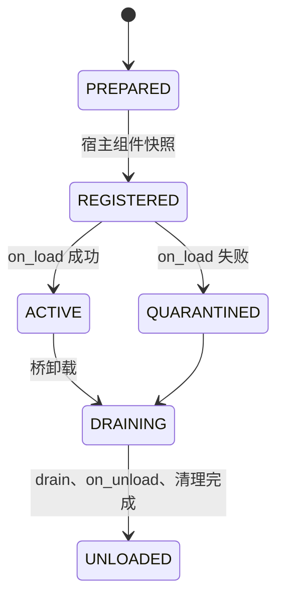

# MaiBot SDK 兼容桥可验证设计

> **状态：受限官方 SDK 子集已实施；focused、宿主 PluginManager/EventBus 集成与入站媒体/显式 LLM 覆盖验收通过。**  
> **SDK 基线：`maibot-plugin-sdk==2.17.0`。**  
> 本文定义 `MofoxForMaibotPulgins` 的官方 SDK 2.17.0 兼容子集。桥不再以自制 `maibot_sdk`、YesMai shim 或空实现作为成功依据。

## 实施状态（2026-08）

已实施并有 focused 测试证据：官方 SDK 2.17.0 版本验证与 Context/配置注入、生命周期覆盖
准入、字符串和结构化 Python dependency 的安装/版本校验、递归 YesMai 导入/依赖拒绝、`Command`、`ON_MESSAGE`
EventHandler、Tool/兼容 Action 的 namespaced `BaseTool` 及组件快照缓存、桥域静态/动态 API 原子性、
来源路由的文本/图片/表情发送、入站 plain text/媒体/协议未知段/宿主未知段保留（归一化不修改原始
`raw_data`）、显式 LLM task/model 选择（不可同时传）、`temperature` 与正整数 `max_tokens` 请求参数覆盖、
reasoning/ToolCall 映射和失败传播、状态门与模块前缀清理、受管任务 drain、配置回滚、
`MessageGateway` / `LLMProvider` / `HomeCard` / `HookHandler` 等未支持声明拒绝，以及旧名
`EMofoxForMaibotPulgins` 的非覆盖路径迁移。真实 `PluginManager` / `EventBus` 集成已验证 bundled avatar
命令、来源路由图片发送、构造期 Tool 注册及其反向执行，以及动态 Tool 在宿主 LLM 回路中的真实执行。

旧本地 `maibot_sdk`、YesMai shim、私有 `ConfigManager` 配置合并实现及其手工测试已移除；官方
`maibot-plugin-sdk==2.17.0` 是桥唯一允许的 SDK 运行时。

仍待完成或以真实运行时验证：真实 Adapter 端到端加载、显式 LLM 的实际外部模型供应商网络请求，以及宿主
公开配置扩展 API 出现后的 WebUI 配置集成。官方 SDK 2.17.0 本身没有公开的受管后台任务 capability；桥只
管理自身内部任务，不能伪造第三方 `PluginContext` 的任务注册入口。本文的“实施必须”条目在未被该状态段
明确列为已实施前，仍是验收要求，不应被解释为已完成承诺。

## 1. 决策摘要

MaiBot 桥将运行**官方 2.17.0 SDK 语义的受限子集**，并遵守以下决策：

- 外部插件必须针对 `maibot-plugin-sdk==2.17.0`；导入面、`PluginContext`、组件收集和生命周期以该版本实际源码为准；
- 使用官方 `MaiBotPlugin._set_context()` 和 `set_plugin_config()` 注入，而不是向 `instance.ctx` / `instance.config` 直接赋值；
- `Command`、`Tool`、官方兼容 `Action`、`EventHandler` 的已映射子集和桥域内 API 可工作；
- `Action` 在 2.17.0 中是 Tool 兼容声明，因此映射为宿主 `BaseTool`，**不**伪装为 Neo-MoFox `BaseAction`；
- 无公开且无损宿主映射的 `MessageGateway`、`LLMProvider`、`HomeCard`、`WorkflowStep` 和未映射 `HookHandler` 在准入期拒绝；
- 外部插件使用精确的 `PluginContext` 和受控 RPC 分派；未实现 capability 必须报错，不返回 `True` / 空对象；
- 本文不覆盖 YesMai。若以后需要 YesMai，应另立版本化设计和验收矩阵，不能混入标准 MaiBot 2.17.0 路径。

## 2. 已核验的 SDK 与宿主事实

| 事实 | 设计结论 |
| --- | --- |
| SDK 2.17.0 的组件类型为 `ACTION`、`API`、`COMMAND`、`TOOL`、`EVENT_HANDLER`、`HOOK_HANDLER`、`HOME_CARD`、`MESSAGE_GATEWAY`，且 LLM Provider 独立收集 | 准入必须调用官方 `get_components()` / `get_llm_providers()` 或其等价官方收集函数，不能只扫描自制装饰器。 |
| `WorkflowStep()` 在 SDK 2.17.0 明确抛出 `RuntimeError` | 桥不得把它转为 Hook 或忽略错误。 |
| `MaiBotPlugin.on_load()`、`on_unload()`、`on_config_update()` 基类默认抛 `NotImplementedError` | 生命周期未覆盖的插件不具备可激活资格。 |
| `MaiBotPlugin` 有 `_set_context()`、`set_plugin_config()`、`register_dynamic_api()`、`sync_dynamic_apis()` | 必须通过这些语义入口注入/同步，不直接覆盖私有状态或伪造同步成功。 |
| 官方 `PluginContext` 构造后提供 `api`、`gateway`、`send`、`db`、`llm`、`config`、`emoji`、`message`、`frequency`、`component`、`chat`、`person`、`render`、`knowledge`、`tool`、`statistics`、`maisaka` 等能力代理 | 使用真实 SDK `PluginContext(plugin_id, rpc_call, paths)`，由桥实现受控 `rpc_call`；每个未支持 capability 都明确失败。 |
| 官方 SDK 2.17.0 未公开受管后台任务 capability | 桥可用 `TaskManager` 管理内部协程，但不得添加或伪造 `ctx.register_task()`。 |
| 原始 Host RPC 白名单为 `cap.call`、`host.route_message`、`host.update_message_gateway_state` | 桥的 RPC 接收器也只接受这三个方法名。 |
| Neo-MoFox 插件组件在 `get_components()` 后快照注册，卸载不自动清理桥任务或 Router | 外部工具类必须预生成；桥负责任务、Router 和模块清理。 |
| `ModelClientRegistry` 是 slots dataclass，且宿主没有公开通用 Provider 注册接口 | 不能 monkey-patch 客户端选择逻辑支持 `@LLMProvider`。 |
| `Message` 能表达文本、图片、语音、视频、文件、回复和部分元数据，但没有无损通用混合消息链模型 | `hybrid`、forward、custom 等只在确有完整映射时支持；当前设计拒绝无损不了的路径。 |

## 3. 范围、命名与安全边界

- **桥插件名**必须为 `MofoxForMaibotPulgins`。现有错误名 `EMofoxForMaibotPulgins` 仅作为一次性配置迁移来源，不再作为运行时身份。
- **外部单元**是一个目录内 `plugin.py` 中由 `create_plugin()` 返回，或唯一 `MaiBotPlugin` 子类创建的实例。
- **插件 ID**优先取外部 `_manifest.json` 的 `id`，否则使用稳定 slug。宿主组件、任务、数据目录、模块名前缀均使用 slug 隔离。
- **桥域（bridge realm）**是被同一 MaiBot 桥加载的外部单元集合。静态/动态 `API` 仅在该域内可调用，不向 Neo-MoFox 原生插件注册为 Service。
- 外部 Python 代码仍与宿主同进程执行；准入检查不是沙箱。仅加载可信插件，并在日志中避免记录其配置秘密。

## 4. 绝对不变量

1. **只认官方基线。** SDK 版本、公共导出和关键行为需在测试中与 2.17.0 断言；不再让桥自制 stub 悄悄替代它。
2. **不伪成功。** `register_dynamic_api()`、`sync_dynamic_apis()`、发送、LLM、权限、渲染等操作只在真实完成后返回成功。
3. **不直接赋值注入。** 配置经 `set_plugin_config()`，上下文经 `_set_context()`；插件可观察到的是实际官方 `PluginContext` 实例。
4. **不修改私有宿主状态。** 不访问 `ConfigManager._configs`，不 monkey-patch LLM client registry，不通过私有 Adapter/WebSocket 发送。
5. **组件快照前决定宿主组件。** 需要 Neo-MoFox `BaseTool` 的声明在桥构造期预备；运行后出现的宿主工具请求报 `LateComponentRegistrationError`。
6. **桥域 API 原子化。** 任何 API 集合替换要么完全生效，要么完全保留旧表；未知 API、重名冲突和离线插件均为可观察错误。
7. **卸载不会遗留执行体。** 新调用先拒绝，任务、调用 lease、路由和模块随后清理。

## 5. 准入契约

### 5.1 候选插件检查

候选目录必须满足：

1. 存在 `plugin.py`；
2. `_manifest.json`（如存在）声明的 SDK 范围包含 2.17.0；
3. 导入依赖均已由用户通过项目的 `uv` 环境安装；桥不在运行时执行隐式 `pip install`。外部 manifest 中的 Python 依赖应由桥的受控安装/准入流程在导入前报告、安装或拒绝，不能在插件导入后静默缺失；
4. 可创建一个且仅一个 `MaiBotPlugin` 实例；
5. `on_load()`、`on_unload()`、`on_config_update()` 均由插件覆盖，且不等于 SDK 基类的强制 `NotImplementedError` 实现；
6. `set_plugin_config()` 和 `_set_context()` 完成后，官方组件/Provider 收集结果可被桥完全检查；
7. 所有组件、capability 声明、API 名和宿主工具名均通过本节规则。

任何一步失败都回滚该单元的模块和预备登记，并输出 `plugin_id`、文件、错误码和可读原因。

### 5.2 支持的组件

| SDK 声明 | 支持条件 | 宿主映射 |
| --- | --- | --- |
| `@Command` | pattern 可编译，参数可按官方事件载荷调用 | 一个桥事件处理器中的命令派发。 |
| `@Tool` | 参数 schema 可转换，名称非空 | 预备期生成 namespaced `BaseTool`。 |
| `@Action` | 官方 SDK 将其归入 Tool 兼容语义 | 与 `@Tool` 相同，生成 `BaseTool`。 |
| `@EventHandler` | 事件只为 `ON_MESSAGE`，options 在映射表内 | 桥事件处理器内按 `weight`、`intercept_message` 派发。 |
| `@API` | 名称和版本唯一，仅桥域可见 | 桥域 API 注册表。 |
| `register_dynamic_api()` / `sync_dynamic_apis()` | API 只桥域可见，变更通过原子替换 | 桥域 API 注册表。 |
| `config_model` | 可转为桥配置 Section 且字段类型受支持 | `SectionBase` 配置节；前提见第 9 节。 |

### 5.3 硬性拒绝的组件和模式

| SDK 声明/行为 | 拒绝原因 |
| --- | --- |
| `@MessageGateway("receive" / "send" / "duplex")` | 宿主没有可按第三方声明动态安装协议网关的公开等价物；不能把普通事件处理器伪装成网关。 |
| `@LLMProvider` | 宿主无公开的 Provider 注册点；修改 slots 客户端表或拦截私有选择逻辑不可靠。 |
| `@HomeCard` | 宿主没有公开、可按 SDK 数据语义渲染的首页卡片扩展点。 |
| `@HookHandler` | 当前版本未建立可保持 mode/order/error_policy/参数语义的完整映射；不降级为任意 EventBus 订阅。 |
| `WorkflowStep` | SDK 2.17.0 本身已移除。 |
| 旧 `src.plugin_system` / legacy adapter API | 不是 MaiBot SDK 2.17.0 的公共面。 |
| YesMai 导入或 `com.yesmai.*` 依赖 | 独立兼容目标，不属于本桥的 MaiBot 基线。 |
| `EventHandler` 的非 `ON_MESSAGE` 事件 | 还没有可验证的一对一宿主事件映射。 |
| 外部工具在 `on_load()` 之后首次出现 | 已错过宿主组件快照。 |
| 需要未映射 `PluginContext` capability 的声明 | 必须先新增真实映射和测试，不能用空实现通过准入。 |

拒绝的是**单个外部单元**；不影响同桥中独立、已准入的单元。

## 6. 官方 SDK 注入与生命周期

### 6.1 预备阶段

桥构造期间、宿主调用 `get_components()` 之前，对每个单元执行：

1. 解析 manifest、稳定插件 ID 和模块前缀；
2. 导入外部 `plugin.py` 并创建实例；
3. 由官方 `config_model` 生成/校验默认配置，调用 `instance.set_plugin_config(config)`；
4. 创建真实 SDK `PluginContext(plugin_id, rpc_call, paths)`；
5. 调用 `instance._set_context(context)`；
6. 通过 `instance.get_components()` 和 `instance.get_llm_providers()` 收集声明；
7. 执行准入并建立命令、事件、API、工具映射；
8. 为 Tool/Action 生成宿主 `BaseTool` 类；
9. 让桥 `get_components()` 返回桥事件处理器和全部动态工具类。

此阶段不得调用 `on_load()`、发出网络请求或创建后台任务。

### 6.2 激活、隔离和卸载



`on_plugin_loaded()` 中按稳定 slug 顺序调用每个单元的 `on_load()`。失败的单元进入 `QUARANTINED`：其命令、事件、工具和 API 都返回 `UnitUnavailableError`，但其他单元继续工作。

卸载顺序：

1. 置所有单元为 `DRAINING`，从派发表和 API 查找表移除；
2. 取消该单元在 `TaskManager` 中登记的任务；
3. 有界等待正在运行的 handler/tool/API/LLM 调用 lease；
4. 强制取消超时调用并记录证据；
5. 调用 `on_unload()`，单元级独立超时；
6. 清理桥域 API、配置观察器、动态工具反向映射和外部模块前缀；
7. 让宿主继续注销桥组件。

基类生命周期的 `NotImplementedError` 不应在这里被吞掉为成功。

## 7. 组件和事件的真实映射

### 7.1 命令

桥从 `Message` 构造官方风格的结构化载荷：

```text
{
  "plain_text", "raw_message", "message_id", "stream_id",
  "platform", "chat_type", "user_id", "group_id", "sender",
  "reply_to", "is_admin", "media", "unknown_segments"
}
```

其中 `raw_message` 是桥按已知段转换得到的**规范化段列表**，不是声称来自协议端的原始对象。至少转换：`text`、`at`、`reply`、`image`、`emoji`、`voice`、`video`、`file`。原始段没有文本而宿主 plain text 非空时，桥在首位插入 text 段；协议未知段和宿主已解析未知段进入独立 `unknown_segments`，宿主 `extra["media"]` 深拷贝进入 `media`，且归一化不会修改 `raw_data`。例如 `at` 为：

```text
{"type": "at", "data": {"target_user_id": "123"}}
```

这保证头像获取一类插件能从 `kwargs["message"]["raw_message"]` 读取 `@` 段；不得再把 `Message.raw_data` 的字符串直接塞给它。

命令匹配按声明顺序和显式优先级执行。处理器的官方三元返回值必须完整解析并保留第三个布尔决定的拦截语义；桥不得像现状一样丢弃返回值。命中后是否令宿主返回 `EventDecision.STOP` 完全由该 SDK 语义和组件声明决定，而非“所有命令一律阻断”。

### 7.2 EventHandler

仅映射 `ON_MESSAGE`。执行顺序为：

1. `weight` 降序；
2. 同权重按收集顺序稳定排序；
3. 每个处理器读取上一个处理器已允许修改的消息快照；
4. `intercept_message=True` 或处理器返回的明确 blocked 结果使桥返回 `EventDecision.STOP`；
5. 修改结果只可替换现有 `params["message"]`，不能给 EventBus 追加键。

处理器返回值不满足 SDK 支持的规范时，应记录 `InvalidEventHandlerResultError` 并保持先前消息，不可静默视作已处理。

### 7.3 Tool 与 Action

每个 Tool/Action 的宿主名称为：

```text
maibot__{slug}__{external_name}
```

原始名称、外部描述、参数 schema 和所属单元保存在桥反向映射中。即使多个外部插件都声明 `search`，宿主工具名也不冲突。

工具执行时：

1. 检查单元为 `ACTIVE` 并取得调用 lease；
2. 从 `BaseTool` 当前 stream 获取源消息；
3. 调用原始 handler，传入 `stream_id` 和经 schema 校验的参数；
4. 原样规范化成功/失败内容；
5. 释放 lease。

`Action` 不生成 `BaseAction`，因为 2.17.0 的 Action 是兼容 Tool 声明。若插件要求 Neo-MoFox action 选择器语义，应被拒绝而不是得到错误的自动触发行为。

### 7.4 桥域 API 与动态 API

外部静态 `@API` 和 `register_dynamic_api()` 进入以 `(plugin_id, name, version)` 为键的桥域注册表。

- `ctx.api.call()` 只可解析桥域内已激活 API；
- 同一 API 键跨单元冲突，后加载单元拒绝；
- `sync_dynamic_apis()` 触发一次原子替换；成功仅在替换真实完成后返回 `True`；
- API 所属单元卸载后，该 API 立即不可路由并抛 `ApiUnavailableError`；
- API 不转换为 Neo-MoFox `BaseService`，也不假装可被原生插件调用。

这修复当前 `register_dynamic_api` no-op / `sync_dynamic_apis` 恒真问题。

### 7.5 PluginContext capability 分派

桥向官方 `PluginContext` 提供 `rpc_call`，仅接受 SDK 白名单的 `cap.call`、`host.route_message`、`host.update_message_gateway_state`。前两个/后一个的实际 capability 处理遵循下表：

| capability | 支持 | 真实映射 |
| --- | --- | --- |
| `send.text` | 是 | `MessageSender.send_message()`，使用源消息的 stream、平台和目标。 |
| `send.image` | 是 | `MessageType.IMAGE`，仅 Base64/URL/文件来源可表达时发送。 |
| `send.emoji` | 条件支持 | 仅宿主/适配器接受的二进制表情数据。 |
| `send.hybrid`、`send.forward`、`send.command`、`send.custom` | 否 | 没有无损通用消息链/平台命令映射。 |
| `message.get_by_time_in_chat` | 是 | 公开 `message_api.get_messages_by_time_in_chat()`，结果经字段规范化。 |
| `llm.generate` | 是 | 必须显式给出 `task` 或 `model`（二者不可同时给出）；分别通过公开任务/模型解析 API 创建 `LLMRequest`，支持 `temperature`、正整数 `max_tokens`，返回 reasoning/ToolCall 并传播请求失败。 |
| `config.get` | 是 | 当前单元的已验证配置只读快照。 |
| `api.call`、动态 API 替换 | 是 | 第 7.4 节桥域注册表。 |
| `chat.resolve` | 是 | 公开 `stream_api.get_or_create_stream()`。 |
| `person.*`、`permission.*` | 条件支持 | 公开 person/permission API；没有权限数据时返回拒绝，不默认授权。 |
| `gateway.*` | 否 | `MessageGateway` 本身不支持。 |
| `db.*`、`frequency.*`、`component.*`、`knowledge.*`、`tool.*`、`statistics.*`、`maisaka.*` | 否 | 尚无已验证的一对一公开映射。 |
| `render.html2png` | 否 | 宿主当前无 HTML 渲染能力。 |

所有“不支持”项通过 RPC 返回/抛出带 capability 名的 `UnsupportedMaiBotCapabilityError`。不能用空数组、默认管理员、空字符串或“已同步”替代真实实现。

### 7.6 发送和媒体约束

`ctx.send.text()`、`ctx.send.image()` 和条件支持的 `ctx.send.emoji()` 都必须按源消息路由，保留 `stream_id`、`reply_to`、群/私聊目标与平台。发送失败返回实际失败结果。

混合段、转发、平台原生命令和自定义段目前不被拆成多条文本消息，因为那会改变原插件的可观察语义。调用它们必须明确失败。

## 8. 并发、任务和超时

每个单元维护状态锁、活动 lease 计数和被桥创建任务的 `TaskInfo.task_id` 集合：

- command、event handler、tool、API、LLM 进入前获取 lease；
- `DRAINING` / `UNLOADED` 状态拒绝新 lease；
- 外部代码永远不在桥锁内执行；
- 外部插件需要后台任务时，桥以 `TaskManager.create_task()` 创建，并标记 `group_name="compat:maibot:{slug}"`；
- 卸载时取消保存的 ID，有限期等待，再记录强制取消；
- 不允许桥自身使用裸 `asyncio.create_task()`、`ensure_future()` 或未追踪 config poller。

单元级 timeout 由桥配置控制；超时日志必须至少含 plugin ID、调用类型、声明名和是否发生强制取消。

## 9. 外部配置与 WebUI

`PluginConfigBase` 可被转换为 `SectionBase`，但桥只有在宿主提供**公开**“替换/重载插件配置类”的 API 后，才向 WebUI 宣称结构化外部配置可编辑。

实施禁止：

- 直接修改 `ConfigManager._configs`；
- 将 Pydantic 以外的字段强行写入不可变 `model_fields`；
- 保存后只更新 TOML 而不调用 `instance.set_plugin_config()` / `on_config_update()`；
- 配置回调失败后留下半更新的多个单元。

配置更新的原子流程为：解析 TOML → 校验桥配置与外部 Section → 生成每单元配置快照 → 调用 `set_plugin_config()` → 调用 `on_config_update("self", data, version)` → 提交。任何一步失败均回滚本次更新。

如果公开宿主 API未到位，桥只能使用默认/已有配置，并把持久化请求明确报告为不支持。

## 10. 名称迁移

实施时把清单、`plugin_name`、配置路径和数据目录统一为 `MofoxForMaibotPulgins`。

为避免静默丢失配置：

1. 若新路径不存在而旧 `EMofoxForMaibotPulgins` 路径存在，进行一次显式、可记录的复制迁移；
2. 若两者均存在，拒绝自动覆盖并要求用户选择；
3. 数据目录同样采用上述迁移规则；
4. 迁移完成后日志给出旧/新位置与结果，不输出任何敏感配置值。

## 11. 验收测试与证据

实施必须新增至少如下测试：

| 编号 | 场景 | 断言 |
| --- | --- | --- |
| M01 | SDK 身份 | 导入的公共符号、`WorkflowStep` 异常和 `PluginContext` 注入语义符合 2.17.0。 |
| M02 | 生命周期未覆盖 | 基类 `NotImplementedError` 插件被准入拒绝。 |
| M03 | 头像插件载入 | `set_plugin_config()` / `_set_context()` 被调用；`self.ctx` 是官方 `PluginContext`。 |
| M04 | `@` 入站段 | 命令收到结构化 `raw_message` 的 `at.target_user_id`。 |
| M05 | 图片发送 | `ctx.send.image()` 产生正确 `MessageType.IMAGE` 并路由到源会话。 |
| M06 | 命令三元返回 | 第三个布尔的拦截决定生效，返回值未丢失。 |
| M07 | EventHandler 排序 | `weight` 高者先执行，同权重稳定；修改/拦截回写真实 `params["message"]`。 |
| M08 | Tool 与 Action | 两者均生成 namespaced `BaseTool`；Action 没有注册为 `BaseAction`。 |
| M09 | 同名工具 | 两个单元可并存，调用不会串到错误 handler。 |
| M10 | 静态 API / 动态 API | 域内调用成功；冲突、未知和卸载后 API 都明确失败；`sync_dynamic_apis()` 不恒真。 |
| M11 | `MessageGateway` / `LLMProvider` / `HomeCard` / `HookHandler` | 全部在准入期失败，报告声明位置和原因。 |
| M12 | 未支持 capability | 例如 `render.html2png` 抛准确 capability 错误，不返回伪图片。 |
| M13 | 卸载并发 | 新调用被拒绝，现有调用有界 drain，任务和模块前缀无残留。 |
| M14 | 配置事务 | 校验/生命周期回调失败后旧配置保持可用。 |
| M15 | 错误名迁移 | 仅旧路径时可迁移；双路径时绝不覆盖。 |

最低集成证据：使用 `avatar_fetcher_plugin`，向 QQ 群发出带 `@` 的 `/avatar` 命令；验证命令识别、下载后的图片发送、第三返回值的阻断行为，以及桥卸载后无后台任务、无可路由 API。

## 12. 实施顺序与退出标准

1. 替换为官方 2.17.0 SDK 导入面，并建立 SDK 身份测试；
2. 实现预备阶段、官方 Context/配置注入和严格准入；
3. 实现 Command、Tool、Action、`ON_MESSAGE` EventHandler 的真实分派；
4. 实现桥域 API、capability RPC 和媒体发送；
5. 实现任务管理、状态门、卸载 drain 与错误名迁移；
6. 只有宿主公开配置扩展 API 就绪后，实施结构化 WebUI 配置；
7. 删除当前自制 SDK、直接赋值注入、文本降级、旧 YesMai 默认路径、动态 API no-op 和所有伪成功分支。

只有第 11 节全部通过后，README 才可把对应能力标记为“已支持”；其余能力必须继续标记为“拒绝/未支持”。

