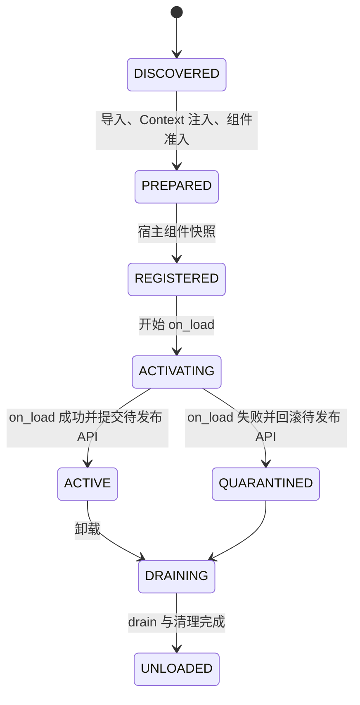

# MaiBot SDK/API 覆盖扩展规格

> 状态：设计已确认，待实施。  
> 上游基线：`maibot-plugin-sdk==2.8.0`，发布于 2026-08-10。  
> 宿主基线：Neo-MoFox 1.3.0-alpha.0。  
> 目标：把官方 SDK 基线升级到 2.8.0，修复动态 API 生命周期与身份语义，并以数据驱动方式扩大可真实执行的 capability 覆盖。

## 1. 决策摘要

本轮采用以下顺序：

1. 桥运行时升级到官方 `maibot-plugin-sdk==2.8.0`；
2. 先修复动态 API 在 `on_load()` 中无法同步、`offline_reason` 被丢弃、API 调用者身份被丢弃等契约问题；
3. 完整实现 2.8.0 的 `ctx.send.*(return_details=True)` 与 `SendResult`；
4. 用统一 capability 注册表替代散落的字符串白名单，逐项扩大公开宿主 API 映射；
5. legacy `src.plugin_system` profile 改用官方 `maibot_sdk.compat`，停止维护平行 ABI；
6. 无法保留语义的 capability 继续明确拒绝。

本规格是现有 [DESIGN.md](../DESIGN.md) 的增量设计。完成实施和测试后，主设计中的 SDK 2.7.1 基线及 legacy 拒绝条目必须同步更新。

## 2. SDK 2.8.0 已核验变化

2.8.0 相对 2.7.1 的公开变化集中在发送结果契约，而不是新增发送方法：

- 新增 `SendResult`：

```text
{
  "sent": bool,
  "message_id": str | None
}
```

- 所有 `ctx.send.*` 方法新增关键字参数 `return_details: bool = False`；
- 默认调用仍返回 `bool`；
- `return_details=True` 时返回 `SendResult`；
- `PluginContext` 会从 Host RPC 结果中的 `success/sent/message_id` 规范化结果；
- `text`、`image`、`emoji`、`forward`、`hybrid`、`command`、`custom` 七个方法在 2.7.1 已存在，2.8.0 为它们补上统一的类型化详细返回。

当前桥只执行其中的 `text`、`image`、`emoji`，且 handler 只返回布尔值，无法满足详细返回；`forward`、`hybrid`、`command`、`custom` 是既有但尚未执行覆盖的 SDK 能力。图片参数读取 `image_base64` 是正确的，不需要改成 `image_data`。

## 3. 当前基线与已确认偏差

| 位置 | 当前行为 | 目标行为 |
| --- | --- | --- |
| `sdk/__init__.py` | 精确要求 2.7.1 | 精确要求 2.8.0，并验证 `SendResult` 和新增发送方法 |
| `MaiBotRuntime.activate()` | `on_load()` 执行时状态为 `REGISTERED` | 增加 `ACTIVATING`；允许初始化期间同步动态 API |
| `MaiBotRealm.replace_dynamic_apis()` | 只允许 `ACTIVE`，且 `del offline_reason` | 允许 `ACTIVATING/ACTIVE`；保存并返回离线原因语义 |
| `MaiBotRealm.call_api()` | `del requester` | 保留调用者身份，用于可见性、审计和递归调用保护 |
| `_SUPPORTED_CAPABILITIES` | 手工集合，只有 15 项 | 数据驱动注册表，每项都带 handler、状态、权限和测试编号 |
| send handler | 返回 `bool` | Host RPC 始终返回结构化发送结果，由 SDK 决定布尔或详情视图 |
| `legacy_runtime.py` | 自制 `src.plugin_system` 类型与导入面 | 使用官方 `maibot_sdk.compat`，桥只保留宿主适配层 |
| `config_merger.py` | 写 `ConfigManager._configs` | 只使用宿主公开配置 API；若无公开入口则不宣称动态 WebUI 合并 |

## 4. SDK 版本与插件准入

### 4.1 运行时版本

桥的 Python 依赖和运行时检查统一为：

```text
maibot-plugin-sdk==2.8.0
```

`require_official_sdk()` 至少验证：

- `__version__ == "2.8.0"`；
- `MaiBotPlugin`、`PluginContext`、`PluginPaths`；
- `Tool`、`Command`、`Action`、`API`；
- 顶层导出的 `SendResult`；
- `SendCapability` 的七个发送方法和 `return_details` 参数；
- 官方 `maibot_sdk.compat` 模块与 `maibot_sdk.compat.legacy_adapter.LegacyPluginAdapter`；
- 桥自己的版本固定 compat 适配器可调用 2.8.0 的 `_import_hook.install_hook()` / `uninstall_hook()` 和 `_context_holder`。这些下划线模块属于官方包的内部实现面，不得宣称为稳定公共 API，升级 SDK 时必须由契约测试重新核验。

桥不得在 `sys.modules` 注入自制 `maibot_sdk`。

### 4.2 外部插件版本声明

- manifest 的 SDK 约束必须包含 2.8.0；
- 精确声明 `==2.7.1` 的插件不被桥静默当作 2.8.0 插件，应提示更新 manifest；
- 未声明 SDK 版本的插件可进入兼容扫描，但必须通过 2.8.0 的完整导入和组件准入测试；
- 保留一组 2.7.1 源码兼容 fixture，验证 2.8.0 的默认发送返回仍为 `bool`，但这不覆盖外部 manifest 的精确依赖约束。

## 5. 生命周期、API 身份与可见性

### 5.1 状态机替换



`register_dynamic_api()` / `sync_dynamic_apis()` 仅在 `ACTIVATING` 和 `ACTIVE` 可用。`ACTIVATING` 阶段只写入待提交集合；`on_load()` 成功后原子发布，失败时完整丢弃。静态 API 也只有在单元为 `ACTIVE` 时可路由。

### 5.2 API record 与唯一键

API 唯一键固定为：

```text
(provider_plugin_id, api_name, version)
```

活动 `ApiRecord` 至少保存：

```text
provider_plugin_id
api_name
version
description
public
dynamic
revision
handler
```

规则：

- 空 version 参与唯一键；
- 同一 provider 下同名同版本冲突时整次准入或 replace 失败；
- 静态 `@API` 与动态 API 的 `public` 缺省值均为 `False`；
- fully-qualified name 固定为 `plugin_id.api_name`；
- API name 和 plugin id 可以含点，因此 Realm 必须建立 `qualified_name -> ApiKey` 精确索引，不能用 `split/rsplit` 反解析；
- 若两个不同 ApiKey 生成同一 fully-qualified string，后注册的静态准入或动态 replace 整体失败；活动记录与未清理 tombstone 都参与碰撞检查；
- handler 永远不进入元数据返回值。

### 5.3 requester-aware visibility

`api.call`、`api.get`、`api.list` 都必须把 requester unit 传入 Realm，不得只在 `call` 路径保留身份。可见性规则固定为：

- provider 可访问自己的 public/private API；
- 其他 unit 只可访问 `public=True` 的 API；
- `api.list(plugin_id=...)` 先按 requester 权限过滤，再按 provider 过滤，只返回活动记录；
- fully-qualified name 只消除名称歧义，不绕过 private；
- 短名解析只在 requester 可见的活动记录中唯一时成立，不可见记录不制造歧义；
- 对其他 unit，private API 与不存在 API 使用相同的 `ApiUnavailableError`，避免泄露其存在。

`api.get` 与 `api.list` 的活动元数据固定为：

```text
plugin_id, api_name, version, description, public, dynamic, revision, online=True
```

### 5.4 Dynamic API 原子替换与 tombstone

`replace_dynamic_apis()` 是 provider 自身动态 API 集合的原子替换，不是增量追加：

1. 仅 requester 本人可替换自己的动态 API；
2. 校验全部声明、handler、元数据、重复 key 和静态 API 冲突；
3. 在 Realm 锁内提交新集合并递增 provider revision，旧集合与新集合之间没有可观察空窗；
4. 返回 `success/count/revision/offline_reason`；
5. 任一项无效时整次失败，不改变活动集合。

`offline_reason` 必须规范化为非空安全文本。每个被移除 key 建立独立 `ApiTombstone`：

```text
provider_plugin_id, api_name, version, public, revision, offline_reason
```

解析规则：

- `api.call` 优先解析活动记录；没有活动记录且唯一可见 tombstone 命中时，抛出包含该 `offline_reason` 的 `ApiUnavailableError`；
- `api.get` 对可见 tombstone 返回 `online=False`、`revision`、`offline_reason`，不返回 handler；
- `api.list` 只列活动 API，不把已下线项当作可调用能力；
- tombstone 保留原记录的 `public`，private tombstone 仍只对 owner 可见；
- 同一 key 被重新发布时删除对应 tombstone；
- unit 完整卸载时删除其活动记录、待提交集合、revision 和全部 tombstone。

### 5.5 recursion guard

API 调用链使用 `ContextVar` 保存：

```text
requester_plugin_id
target_api_key_stack
call_depth
```

- 同一调用链内目标 key 已存在时，立即抛 `ApiRecursionError`；
- 最大跨插件 API 深度可配置，默认 16，超限抛 `ApiDepthExceededError`；
- 调用结束后无论成功、失败或取消都必须 reset context token；
- 审计记录 requester、target、version 和 depth，但不记录 API 敏感参数。

### 5.6 unload invalidation 与并发

unit 进入 `DRAINING` 后拒绝新 API 调用。Realm 必须在锁内完成解析和 inflight 获取，再在锁外执行 handler，避免解析成功后 provider 在计数前卸载。

已开始调用纳入 inflight 计数并有界排空；排空后移除静态/动态 API、待提交集合、revision 和 tombstone。Realm 不向调用方泄露可长期缓存的裸 handler；任何旧元数据或句柄在卸载后再次使用都必须失败。

## 6. 发送结果契约

### 6.1 Host RPC 返回

所有已支持的 `send.*` handler 对 SDK RPC 返回统一结构：

```text
{
  "success": bool,
  "sent": bool,
  "message_id": str | None
}
```

这样 2.8.0 `PluginContext` 会按调用方式返回：

- `return_details=False` -> `bool(success)`；
- `return_details=True` -> `{"sent": ..., "message_id": ...}`。

发送失败不得返回 `success=True`。平台没有公开最终消息 ID 时，`message_id=None` 是合法且诚实的结果；若 Adapter/Service 返回确认 ID，桥必须保留该 ID。

### 6.2 已支持发送

| capability | 状态 | 映射 |
| --- | --- | --- |
| `send.text` | E | 公开 `send_api` / `MessageSender`，绑定来源 stream |
| `send.image` | E | `image_base64` -> `MessageType.IMAGE`，不得文本降级 |
| `send.emoji` | C | `emoji_base64` -> `MessageType.EMOJI`，目标 Adapter 必须支持 |
| `send.hybrid` | C | 仅当目标 Adapter 能在单条消息中保留 text/image 段顺序；不能拆成多条消息 |
| `send.forward` | C | 仅 OneBot profile，且 `onebot_expand>=1.0.13` 与 message service 可用 |
| `send.command` | I | 2.8.0 可导入；宿主没有通用“平台命令消息”语义时明确失败 |
| `send.custom` | I | 任意自定义类型无通用映射，必须按已登记 adapter capability 才可执行 |

`emoji`、`hybrid`、`forward` 在真实 Adapter/Service 验收前不得提升为 `E`，也不计入基础环境覆盖率。

### 6.3 来源与 ID

- 所有发送必须使用真实来源 `stream_id`；
- 不存在来源消息时抛 `UnitUnavailableError`；
- reply、群/私聊目标和 adapter signature 必须从来源消息保留；
- 最终消息 ID 只取 Adapter/Service 的明确确认响应，或已经由公开发送 API 文档保证的回写字段；没有该证据时为 `None`；
- 不能使用请求前临时 ID 冒充平台确认 ID。

## 7. Capability 注册表与固定交付矩阵

### 7.1 单一真相源

以单一注册表替换 `_SUPPORTED_CAPABILITIES` 和长 `if/elif` 分派：

```text
CapabilitySpec(
  name,
  support_level,
  handler,
  input_validator,
  source_api,
  requires_source_message,
  permission_policy,
  dependency_probe,
  result_mode,
  result_key,
  result_contract,
  error_contract,
  test_id,
)
```

支持等级：

- `E`：在桥基础依赖与有效入参内无条件真实执行；
- `C`：只有明确的平台、组件或服务前置条件满足时真实执行；
- `I`：SDK 导入可用，调用明确失败；
- `R`：manifest 声明时准入拒绝。

manifest 准入、运行时 dispatch、文档矩阵和参数化测试必须读取同一份 registry。启动自检保证每个 `E/C` 项都有 handler、validator、permission policy、result mode、result contract 和测试编号；SDK 2.8.0 的公开 capability 全部分类。不存在于 registry 的 capability 按 `R` 处理：manifest 声明时拒绝，动态字符串调用时抛 `UnsupportedMaiBotCapabilityError`。

### 7.2 首期固定矩阵

本规格锁定以下矩阵；实施计划不得把 `I/R` 项默认为“顺手补齐”，状态变化必须另写设计。

| 状态 | capability | 本阶段合同 |
| --- | --- | --- |
| `E` | `api.call/get/list/replace_dynamic` | 使用第 5 节 requester、privacy、revision 与 tombstone 合同 |
| `E` | `config.get/get_all/get_plugin` | 只读取当前 unit 的完整配置快照，不跨 unit 读取 |
| `E` | `llm.generate` | 映射 Neo-MoFox 公共 LLM API，保留成功和错误语义 |
| `E` | `llm.embed` | 映射公共 embedding API，保持输入顺序和向量数量；部分失败视为整次失败 |
| `E` | `message.get_recent/get_by_time_in_chat/count_new/build_readable` | 仅作用于当前调用链或管理员授权的 stream，使用第 7.3 节合同 |
| `C` | `message.get_by_time` | 仅管理员授予该 unit 全局历史读取权限时执行 |
| `C` | `chat.get_all_streams/get_group_streams/get_private_streams/get_stream_by_group_id/get_stream_by_user_id` | 仅返回该 unit 有权发现的 stream；全局枚举需管理员显式授权 |
| `E` | `person.get_id` | 仅做公共 person-id 生成，不冒充人物库查询 |
| `E` | `component.get_all_plugins/get_plugin_info/list_loaded_plugins/list_registered_plugins` | 只读脱敏插件元数据；宿主不能区分 loaded/registered 时启动自检降为 `I` |
| `E` | `send.text/send.image` | 对有效宿主 stream 使用公共 send API，并遵守 2.8.0 `SendResult` 合同 |
| `C` | `send.emoji/send.hybrid/send.forward` | 仅在第 7.6 节条件满足时执行，否则明确失败 |
| `I` | `send.command/send.custom` | 没有无损宿主映射，调用抛 `UnsupportedMaiBotCapabilityError` |
| `I` | `chat.open_session` | 当前宿主 stream 身份不保留 SDK 的 `account_id/scope`，不能保证多账号路由 |
| `I` | `message.get_by_id` | 宿主无稳定公开 ID 查询合同 |
| `I` | `person.get_id_by_name/person.get_value` | 不用猜测或私有数据库模拟人物语义 |
| `I` | `llm.get_available_models`、ASR 与 tool-calling 入口 | 需单独定义模型身份、音频和工具执行合同 |
| `I` | `database.*` | 不向外部 unit 暴露宿主 ORM/model 任意读写 |
| `I` | `emoji.*` 查询/管理 | 宿主没有与 MaiBot 表情库等价的公开合同 |
| `I` | `frequency.*`、`knowledge.*`、`statistics.*`、`render.*`、`tool.get_definitions` | 语义或权限边界未对齐 |
| `I` | component 的 load/unload/reload/enable/disable 等变更操作 | 不允许外部 unit 改变宿主插件生命周期 |
| `I` | `gateway.*`、`maisaka.*` | 需要独立的入口身份、路由授权和去重设计 |

### 7.3 消息查询合同

消息查询在 handler 边界完成一次参数校验：

- 时间参数接受 SDK 2.8.0 声明的字符串或数值时间，规范化失败显式报错，不退回 `0`；
- `start_time <= end_time`，`limit >= 0`；`limit=0` 保留 SDK 的“不额外限制”语义；
- `get_by_time` 是全局查询，必须先通过管理员全局历史权限检查；`get_by_time_in_chat` 必须在宿主查询层限制指定 stream，不做全局查询后内存猜选；
- `count_new` 使用宿主计数能力，不把拉取列表长度冒充精确计数；
- 所有消息通过同一 serializer 输出，不返回 ORM 实例；
- `build_readable` 只接受该 serializer 产生的 DTO 或当前调用链内的宿主 `Message`，不可解析输入显式失败。

`MessageDTO` 至少稳定包含：

```text
message_id, stream_id, time, sender_id, sender_name, text, message_type
```

缺失字段使用 `None`，不从其他消息或会话补猜。

### 7.4 unit 数据访问授权

外部 unit 不能通过自身配置给自己提权。bridge 管理员在独立文件中授予数据访问权限：

```text
config/plugins/mofox_for_maibot_plugins/access.toml
```

每个稳定 unit storage id 的策略至少包含：

```text
allowed_stream_ids = []
allow_global_message_read = false
allow_global_stream_discovery = false
```

授权规则固定为：

- 当前 EventHandler、Command、Action 或 Tool 调用链携带的真实 `stream_id` 在该调用链内临时授权；
- 后台调用只能访问管理员 `allowed_stream_ids` 中的 stream；
- `message.get_recent/get_by_time_in_chat/count_new/build_readable` 必须命中临时授权或静态 allowlist；
- `message.get_by_time` 只有 `allow_global_message_read=True` 时可执行，否则抛不泄露数据范围的权限错误；
- chat 列表和按 group/user 查询默认只可返回 allowlist 中的 stream；只有 `allow_global_stream_discovery=True` 时才可枚举全部公开 stream；
- 数据访问拒绝不得通过空列表伪装成功，必须使用稳定的 capability permission error；
- access policy 不通过 `ctx.config` 暴露，也不接受外部 unit 动态修改。

这是一项宿主管理策略，不改变 SDK 的参数签名。README 必须说明全局历史与全局 stream 枚举默认关闭。

### 7.5 stream 与插件元数据 DTO

stream 查询只返回：

```text
stream_id, platform, chat_type, user_id, group_id, display_name
```

仅填充宿主公开对象明确提供的字段。单项查询未命中返回 `None`；列表按 `(platform, chat_type, stream_id)` 稳定排序，并在序列化前应用第 7.4 节权限过滤。

`chat.open_session` 本阶段为 `I`：SDK 2.8.0 接受 `account_id` 与 `scope`，而当前 Neo-MoFox `stream_api.get_or_create_stream()` 只以 platform/user/group/chat type 建立身份，不能无损表达多账号和路由范围。bridge 不得忽略这两个字段，也不得选取 platform 的“首个 adapter”代替指定账号。未来只有在宿主公开 stream/route identity 同时保存 account、scope 与 adapter signature 后才可升级。

插件元数据只返回：

```text
plugin_id, display_name, version, description, author, loaded, registered
```

字段无法从宿主公开 API 确定时为 `None`。不得返回路径、类、配置、实例或 Registry 对象，也不得读取私有容器。`list_loaded_plugins` 与 `list_registered_plugins` 必须依据公开状态区分；若目标宿主版本不能区分，两项在启动自检时降为 `I`，不能用同一列表伪装两种语义。

### 7.6 条件发送合同

`send.emoji`、`send.hybrid`、`send.forward` 为 `C`，不计入基础环境的无条件覆盖率。共同前置条件为：

- `stream_id` 可解析到唯一宿主 stream、platform 与 user/group target；
- 对应 adapter/service 当前可用；
- 所有输入 segment 均可无损表示；
- 底层结果可归一为第 6 节 `SendResult`。

额外规则：

- `send.emoji` 只在 adapter 明确支持 emoji/图片段时执行，不把描述文本当作成功发送；
- `send.hybrid` 保持 segment 顺序，发现未知 segment 时整次拒绝，不丢段降级或拆成多条；
- `send.forward` 仅支持 OneBot profile，要求 `onebot_expand>=1.0.13` 且 `onebot_expand:service:message_service` 可用；
- forward handler 只调用该服务公开 forward API，并按真实响应字段解析 message id、错误和原始响应；不得仅以“未抛异常”判成功；
- manifest 声明 `send.forward` 时在准入阶段执行版本和 service probe；未声明但运行时调用时重复相同 probe 并明确失败。

#### 7.6.1 OneBot forward action 与后端矩阵

`send.forward` 依赖 `onebot_expand` 的 `MessageService`。allowed action 由来源 stream 的 chat_type 与 adapter 后端共同决定，禁止仅凭 service 存在就放行：

| chat_type | backend | action | 必填 params |
| --- | --- | --- | --- |
| group | napcat | `send_forward_msg` | `group_id`、`messages` |
| private | napcat | `send_forward_msg` | `user_id`、`messages` |
| group | go-cqhttp 兼容 | `send_group_forward_msg` | `group_id`、`messages` |
| private | go-cqhttp 兼容 | `send_private_forward_msg` | `user_id`、`messages` |
| 任意 | snowluma | 按 `ALL_APIS` 的 `snowluma_compat` 判定；未声明兼容的 action 返回 `retcode=1404` 且桥判失败 |

backend 取 `onebot_expand` 配置的 `adapter.backend`；`snowluma_compat_mode=True` 时按 snowluma 处理。action 必须在 `ALL_APIS` 中存在且其 `snowluma_compat` 与当前后端匹配，否则 dependency probe 失败。

#### 7.6.2 forward node schema 与转换

SDK 2.8.0 `SendCapability.forward(messages)` 把官方 pydantic `ForwardNode`（字段 `uin/nick/content`）序列化为 dict 传给 Host。兼容层 `ForwardNode` dataclass 用 `sender_name/sender_id/content/timestamp`。bridge 的 forward handler 接受且仅接受以下三种节点表示，其他形状整次拒绝：

1. 标准 OneBot node 段：`{"type": "node", "data": {"uin": str, "name": str, "content": str | list[segment]}}`；
2. SDK pydantic 别名：`{"uin": str, "nick": str, "content": str | list[segment]}`；
3. 兼容层 dataclass 别名：`{"sender_id": str, "sender_name": str, "content": str | list[segment], "timestamp": int?}`。

`content` 为字符串时桥构造单个 text 段；为列表时必须是已登记的 OneBot 消息段，当前仅接受 `text`、`image`、`face`。未知段类型整次拒绝，不丢段、不替换、不拆条。`timestamp` 可选且仅在协议端文档明确接受时透传。

#### 7.6.3 OneBot envelope 成功判定

`_call_onebot_api` 在协议错误时也返回字典而非抛异常，因此 forward handler 必须显式判定 envelope：

- `status == "ok"` 且 `retcode == 0` 视为成功；
- 其他 `status`（`failed`、`async` 未完成、`error`）或非零 `retcode` 视为失败，`sent=False`；
- `message_id` 只从 `data.message_id` 提取；缺失时为 `None`，不使用 echo、res_id 或请求前临时值冒充；
- 异常、超时和未抛异常的错误 envelope 都映射为 `sent=False`，并在错误摘要中保留 `retcode` 与 `msg`。

### 7.7 capability 返回模式

registry 的 `result_mode` 只能取以下值：

| 模式 | Host 返回 | SDK 公开结果 |
| --- | --- | --- |
| `key_unwrap` | `{"success": true, <result_key>: value}` | `PluginContext` 按 2.8.0 `_CAPABILITY_RESULT_KEYS` 返回 `value` |
| `passthrough_dict` | 含 `success` 的完整业务字典 | SDK 原样返回完整字典 |
| `boolean_success` | `{"success": bool}` | SDK 返回 bool |
| `send_detail` | `success/sent/message_id` | SDK 按 `return_details` 返回 bool 或 `SendResult` |

`api.call/get/list`、message/chat/component 等已有 SDK result key 的能力使用 `key_unwrap`。`api.replace_dynamic`、`llm.generate`、`llm.embed` 使用 `passthrough_dict`；它们不在 2.8.0 `_CAPABILITY_RESULT_KEYS` 中。官方 `APICapability.replace_dynamic_apis()` 对 passthrough dict 再压缩为公开 bool，因此 `count/revision/offline_reason` 是 Realm 内部响应和 `api.get` 元数据，不宣称由该 SDK 方法直接返回。

`llm.embed` 的 passthrough 结构固定为：

```text
单条: {"success": true, "embedding": list[float], "model": str}
批量: {"success": true, "results": list[list[float]], "model": str}
```

批量 `results` 与输入等长、同序。handler 不返回裸 ORM、异常对象、协程、`Path` 或宿主组件实例。

## 8. LLM 能力补强

现有 `llm.generate` 的 `task` / `model` 互斥、temperature、正整数 max_tokens、reasoning 和 ToolCall 映射继续保留。本轮补充：

- 接受 2.8.0 公共参数名及经过验证的 2.7 兼容别名；
- 结果结构由 capability registry 声明，不在 handler 中临时拼接不一致字段；
- 请求失败保留原始异常类别和安全错误摘要；
- 不把未知 `model_name` 静默解释为 task；
- `llm.embed` 校验输入为单个文本或文本列表，并保持输出数量与输入数量相等；
- `get_available_models`、ASR 和 tool-calling 仍为 `I`，不因导入存在而返回空集合或假结果；
- 增加真实外部模型供应商网络验收，但与普通单测隔离并允许在无凭据环境跳过。

## 9. 官方 legacy compat

### 9.1 版本专用适配边界

`legacy_runtime.py` 不再定义平行的 `ConfigField`、组件装饰器或 `src.plugin_system` 模块树。bridge 和 manifest 精确锁定 `maibot-plugin-sdk==2.8.0`，新增唯一的 `OfficialCompatCoordinator` 与其内部 `Compat280Adapter`。

`Compat280Adapter` 启动时必须验证以下 2.8.0 符号和形状：

- `maibot_sdk.compat._import_hook.install_hook()` / `uninstall_hook()` 可调用；
- `maibot_sdk.compat._context_holder.set_context()`、`activate_plugin()`、`deactivate_plugin()`、`get_context()` 可调用；
- `_contexts` 是可变映射；
- `_current_ctx` 可读取和重新赋值；
- `_active_plugin_id` 提供 `get/set/reset`；
- `maibot_sdk.compat.legacy_adapter.LegacyPluginAdapter` 可导入；
- 官方 compat 基类、装饰器和组件类型身份可导入。

这些私有符号只能在 `Compat280Adapter` 内出现。任一版本或形状守卫失败时：

- legacy profile 整体准入失败，并报告实际 SDK 版本或缺失符号；
- native 2.8.0 profile 仍可运行；
- 不退回桥自维护 ABI；
- 其他 2.8.x patch 版本也不自动放行，必须先更新适配器与合同测试。

### 9.2 进程级 hook 与 unit context

官方 import hook 与 legacy symbol guard 都是进程级能力。`OfficialCompatCoordinator` 使用进程级锁、引用计数，以及每个 unique id 的 `active_count` 与 condition：

1. 第一个 legacy unit 准备前安装第 9.4 节 symbol guard，再调用 `install_hook()`；
2. 每个 unit 以桥 realm id 与外部 plugin id 组成进程内唯一 compat plugin id；
3. 用官方 `set_context()` 注册该唯一 id 对应的 `PluginContext`；
4. 单个 unit 卸载只删除自己的 context 并减少引用计数；
5. 最后一个 legacy unit 清理完成后才调用 `uninstall_hook()` 并恢复 symbol guard 原函数；
6. 一个 unit 的失败或卸载不得移除其他 unit 正在使用的 hook/module alias。

所有会进入外部代码的边界都必须使用同一个 `activate_context(unit)` context manager：

- plugin module 执行和实例构造；
- `get_components()` 与组件实例化；
- `on_load()`、`on_unload()`、配置更新回调；
- EventHandler、Command、Action、Tool 和 API handler 执行；
- bridge task manager 创建的托管任务入口。

`activate_context(unit)` 的顺序固定为：在 coordinator 锁内确认 unit 未 draining 并增加 `active_count` -> 调用官方 `activate_plugin(unique_id)` 获取 token -> 执行外部代码 -> 在 `finally` 中 `deactivate_plugin(token)` -> 减少计数并通知 condition。同步导入/构造与异步生命周期共用相同计数，不得依赖 `_current_ctx` 的“最近注册 context”回退。

unit 进入 `DRAINING` 后禁止新的 context 激活，并等待自己的 `active_count == 0`。coordinator 的计数是删除 context 的唯一放行条件；卸载 task 不能用 task-local `_active_plugin_id` 推断其他 task 是否仍在运行。

legacy profile 不支持外部插件自行创建逃逸后台任务。准入扫描将 `asyncio.create_task`、`asyncio.ensure_future`、event-loop `create_task`、`TaskGroup.create_task` 和等价静态别名列为 `R`；所有由 bridge 支持的长期协程必须通过宿主 `TaskManager` 包装并在整个任务入口使用 `activate_context(unit)`。排空时还要检查该 unit 已登记任务集合为空；发现未登记且栈帧位于 unit 目录的活跃 task 时，卸载失败并保留 context/hook，不清理成假成功。

### 9.3 缺失 context 删除 API 的受控补偿

2.8.0 没有公开注销 context 的函数。`Compat280Adapter.remove_context(unique_id)` 因此执行版本锁定的最小私有清理：

1. 仅在 coordinator 已阻止新激活且 `active_count == 0` 时，在官方 `_context_holder._lock` 保护下从 `_contexts` 删除目标 key；
2. 若 `_current_ctx` 指向被删除对象，则从剩余 `_contexts` 中选择最后注册的 context，或在无剩余项时置为 `None`；
3. 若当前清理 task 的 `_active_plugin_id.get()` 等于目标 key，视为调用边界未退出并抛 `CompatContextError`，不得强行 reset 不属于当前作用域的 token；
4. 清理后直接断言 `unique_id not in _contexts` 且映射值中不存在目标 context 对象；不得调用 `get_context(unique_id)` 验证，因为官方函数在显式 ID 未命中时会回退其他 context；
5. 清理失败记录为 unit unload failure，不能静默留下强引用。

卸载顺序固定为：转 `DRAINING` -> 拒绝新调用 -> 排空 API/组件/任务 -> 在显式 context 中执行 `on_unload()` -> 退出 context -> `remove_context()` -> 减引用计数 -> 必要时 uninstall hook -> 清理 unit 私有模块前缀。

排空超时时仍取消托管任务并尝试 context 清理；若仍检测到该 unique id 为 active，则保留 hook、隔离 unit 并报告不可安全卸载，不伪装成功。

### 9.4 official compat symbol policy

官方模块能导入不代表其行为被桥支持。新增版本化 legacy symbol policy，按完整模块与符号分类：

- `E`：官方 compat 最终调用当前 `PluginContext` 中本规格已标为 `E/C` 的 capability；
- `I`：官方函数只返回同步空列表、`None`、`False`、进程内本地注册表或其他无宿主效果 stub；
- `R`：导入或声明即要求宿主 workflow、全局服务注册、插件生命周期变更或私有数据库对象。

2.8.0 已知必须拒绝或显式失败的范围至少包括：

- `workflow_api` 的执行、发布、trace 和 step 管理；
- `plugin_service_api` 的进程内本地服务注册表；
- `plugin_manage_api` 的路径和宿主插件变更操作；
- `generator_api.get_replyer`；
- `message_api`、`chat_api` 中返回空结果的同步旧函数。

准入扫描使用 AST 识别直接 import、from-import、别名与静态属性调用。对混合 `E/I` 模块的 star import、动态 `getattr` 或无法静态判定的别名传播，采用 `R`，不猜测。

运行时由进程级 `Compat280SymbolGuard` 做第二道防线：

1. 在导入任何外部 legacy 模块前，按版本化 policy 预先导入官方 compat 真实模块；
2. 对所有 `I/R` 的模块函数和类属性安装 wrapper，并保存原对象；
3. wrapper 根据 `_active_plugin_id` 验证调用来自已登记 unit，然后抛稳定的 unsupported/admission error，不执行官方空返回或进程内本地注册表；
4. 因 wrapper 在外部导入前安装，`from ... import func` 缓存到的也是受保护 callable；动态 import、`getattr`、别名和继承方法都必须有测试；
5. 最后一个 legacy unit 卸载后恢复全部原对象并清空 guard 状态。

官方 `uninstall_hook()` 后，coordinator 还必须验证：compat finder 已从 `sys.meta_path` 消失、`sys.modules` 不含 `src.plugin_system` 前缀、真实 Neo-MoFox `src` 包上不存在由本次 hook 新增且仍指向 compat alias 的 `plugin_system` 父属性。若安装前已有真实同名属性则保存并恢复，绝不删除宿主原对象。

允许的 legacy 符号必须有合同测试证明结果来自当前 unit 的真实 `PluginContext`；仅验证 import 成功不算通过。旧 Command 可继续映射；Action/Tool/EventHandler 只有在官方声明和宿主执行合同都完整时进入 `E/C`。YesMai 与 Scheduler 继续不在本规格支持范围内，legacy profile 使用独立矩阵，不能借用 native profile 的通过结果。

## 10. Bridge-owned 配置存储

删除 `install_merged_config()` 对 `ConfigManager._configs` 的直接写入，也不替换宿主已缓存的配置实例。Neo-MoFox WebUI 只编辑 bridge 自身静态 `MaiBotCompatConfig`；本阶段明确不宣称动态 unit section 已集成 WebUI。

每个外部 unit 的配置存放在：

```text
config/plugins/mofox_for_maibot_plugins/units/<unit-slug>.toml
```

规则：

- 使用官方 `PluginConfigBase` 默认值、schema 与校验构造不可变配置快照；
- 文件更新使用同目录临时文件、flush/fsync 和原子替换，读取端只观察完整版本；
- `ctx.config.get*` 与 legacy config API 只读当前 unit 快照，不跨 unit；
- 配置回调在该 unit 的显式 compat context 和配置锁内执行；
- schema 转换代码只用于校验、迁移或未来公开 WebUI 扩展点，不再用于 monkeypatch 宿主缓存。

从旧合并配置迁移时，使用幂等状态机，保证崩溃恢复和回滚可逆：

1. 旧 section 命名固定为外部插件在旧 `config.toml` 中的顶层 section 名（例如 `[maibot_wife_plugin]`）。unit storage id 由该 section 名稳定派生，不得使用目录路径或运行时实例 id；
2. 旧 section 内的 `section__field` 双下划线扁平字段按 `__` 拆分为嵌套配置路径；单下划线保留为字段名的一部分；拆分后必须能被官方 `PluginConfigBase` 校验，否则该 unit 准入失败并保留旧文件；
3. 每个 unit 的迁移 marker 记录 `prepared/committed/rolled_back` 三态：
   - `prepared`：已读取并校验旧 section，候选 TOML 已写入同目录临时文件但未替换目标；
   - `committed`：候选文件已原子替换为目标 `<unit-storage-id>.toml`，旧 section 不再被读取；
   - `rolled_back`：已按反向迁移把目标 TOML 重建为旧 section 并写回旧合并文件；
4. 若目标 `<unit-storage-id>.toml` 在迁移前已存在且内容不同，迁移失败并报告冲突，不覆盖用户配置；冲突消除前该 unit 准入失败；
5. 任何步骤崩溃后，下次启动按 marker 状态恢复：`prepared` 重写候选并提交或清理临时文件；`committed` 直接使用目标文件；`rolled_back` 视为未迁移；
6. 校验失败则保留旧文件并拒绝该 unit，不覆盖用户配置；
7. 标记成功后不再读取或写入宿主私有缓存；
8. Plan 4 回滚旧代码前，必须先对所有 `committed` unit 执行反向迁移，把目标 TOML 重建为旧 section 并写回旧合并文件；反向迁移同样使用原子写入和 marker，失败则中止回滚并报告。

配置更新事务固定为：读取候选 -> model 校验 -> 获取 unit 配置锁 -> 原子写入候选文件 -> 交换快照 -> 调用 `on_config_update()`。回调失败时恢复旧快照并原子写回旧文件；恢复失败抛 `ConfigTransactionError` 并隔离 unit。

## 11. 分阶段实施边界

本设计拆为四个依次验收、可独立回滚的实施计划。每个计划完成后先更新 README/覆盖矩阵并执行生产加载验收，再进入下一个计划；不得用后一阶段代码补偿当前阶段未通过的合同。

### Plan 1：SDK 2.8.0 与发送结果

涉及 dependency、manifest、`sdk/__init__.py` 和现有 send handler：

- 精确升级并验证 2.8.0；
- 增加 `SendResult` 类型身份与七个方法签名测试；
- 已有 send handler 返回结构化 RPC 结果；
- 覆盖默认 bool 和 `return_details=True`；
- 保持 `image_base64` / `emoji_base64` 参数契约；
- 不在本阶段新增 capability 或替换 legacy runtime。

验收：M2801 至 M2805 全部通过。

### Plan 2：API identity、privacy 与 lifecycle

- 加入 `ACTIVATING` 和待提交动态集合；
- 引入 requester-aware `ApiRecord`；
- 实现 `public=False` 默认值、短名/全名解析与元数据过滤；
- 实现 revision、逐 key tombstone、`offline_reason`、recursion guard 和 unload invalidation；
- 不在本阶段扩展消息、stream 或 embedding 能力。

验收：M2806 至 M2814、M2830 全部通过。

### Plan 3：Capability registry 与首期扩展

- 引入 `CapabilitySpec`，让 manifest、dispatch、文档和测试读取同一 registry；
- 迁移现有能力并实现第 7.2 节固定的新 `E` 项；
- 实现三项 `C` 发送能力及 dependency probe；
- 将其余项固定为 `I/R`，不访问宿主私有状态；
- 输出由 registry 生成的 native capability 矩阵。

验收：M2815 至 M2822 全部通过，其中 M2816、M2817、M2821 必须覆盖第 7.4、7.6 节的授权与协议判定。

### Plan 4：Official compat 与配置清理

- 用 `OfficialCompatCoordinator` 和 `Compat280Adapter` 替换自制 legacy ABI；
- 加入版本化 symbol policy、context 清理与 hook 引用计数；
- 迁移到 bridge-owned unit config store；
- 删除 `ConfigManager._configs` 写入；
- 输出独立 legacy 符号/能力矩阵。

验收：M2823 至 M2829 全部通过，其中 M2824 至 M2827 必须覆盖第 9.2、9.3、9.4 节的 active 计数、context 清理断言、hook 后置条件与运行时 symbol guard。

## 12. 验收测试

| 编号 | 场景 | 断言 |
| --- | --- | --- |
| M2801 | SDK 身份 | 版本为 2.8.0，顶层 `SendResult` 存在，七个既有发送方法均带 `return_details` |
| M2802 | 2.7 风格默认发送 | 不传 `return_details` 时仍得到 `bool` |
| M2803 | 文本详细发送 | `return_details=True` 得到 `sent/message_id` |
| M2804 | 图片/表情参数 | Host 收到 `image_base64` / `emoji_base64`，没有字段错配 |
| M2805 | 发送失败 | bool 为 False；详细结果 `sent=False`，不伪造 message_id |
| M2806 | `on_load()` 动态同步 | `ACTIVATING` 阶段成功提交，激活后可调用 |
| M2807 | `on_load()` 失败 | 本阶段动态 API 回滚，单元隔离 |
| M2808 | private 默认值 | 静态和动态 API 缺省 `public=False`；owner 可见，其他 unit 不可见 |
| M2809 | fully-qualified privacy | 猜测 `plugin_id.api_name` 不能绕过 private，错误不泄露存在性 |
| M2810 | 短名解析 | 只基于 requester 可见活动集合判断唯一性和版本 |
| M2811 | 动态 tombstone | 被移除 key 保存 public/revision/offline_reason；`get` 返回 offline 元数据，`list` 不列出 |
| M2812 | 重发与卸载 | 同 key 重发删除 tombstone；卸载清空 record、pending、revision 和 tombstone |
| M2813 | requester 与递归 | 审计使用真实调用方；递归和深度超限稳定失败，ContextVar 正确 reset |
| M2814 | API 并发卸载 | 解析与 inflight 获取无竞态，旧句柄不能在 drain 后调用 |
| M2815 | capability 自检 | SDK 2.8.0 公开 capability 均有 E/C/I/R 分类，四个使用面读取同一 registry |
| M2816 | 消息扩面与授权 | by-time/count/readable 使用公共 API、参数校验和统一 `MessageDTO`；当前调用链 stream 与管理员 allowlist 之外的访问稳定拒绝 |
| M2817 | stream 扩面与授权 | 列表与单项查询使用公共 API、稳定排序、无跨流猜测；全局枚举仅在 `allow_global_stream_discovery=True` 时返回全部 |
| M2818 | 插件元数据 | 结果脱敏；不能区分 loaded/registered 时对应能力降为 I |
| M2819 | embedding | 输入与向量数量、顺序一致；部分失败不返回半套结果 |
| M2820 | 条件发送 | emoji/hybrid 条件满足时真实成功，条件缺失时稳定失败且不降级 |
| M2821 | OneBot forward | 后端/action 矩阵、node schema、envelope `status/retcode` 与 `message_id` 提取全部符合第 7.6 节；错误 envelope 未抛异常时判失败 |
| M2822 | I/R 能力 | 每项显式失败，未知 capability 无默认成功，返回包装符合 SDK 解包合同 |
| M2823 | compat 版本守卫 | 仅精确 2.8.0 私有形状通过；legacy 失败不影响 native profile |
| M2824 | 多 legacy context | 两个 unit 的生命周期、组件、API 和 task context 不串线；coordinator `active_count` 是删除 context 的唯一放行条件 |
| M2825 | compat context 清理 | 单 unit 卸载删除自身 context，不影响其他 unit；清理用 `unique_id not in _contexts` 断言，不用 `get_context()`；最后无强引用残留 |
| M2826 | 全局 hook 生命周期 | 第一个 unit 安装，最后一个 unit 才卸载；失败 unit 不破坏其他 alias；卸载后 `sys.meta_path`/`sys.modules`/真实 `src` 父属性无残留 |
| M2827 | legacy symbol policy | no-op、local-only 与 workflow stub 被准入拒绝或调用显式失败；动态 import、`getattr`、别名和继承方法路径均有反例 |
| M2828 | 配置迁移与回滚 | 旧 section 命名与 `__` 反扁平化正确；`prepared/committed/rolled_back` 状态机在写文件后、写 marker 后断电均能幂等恢复；目标冲突拒绝；Plan 4 回滚前反向迁移成功 |
| M2829 | 真实宿主加载 | `PluginManager.load_plugin_from_manifest()` 完成 native/legacy 加载与卸载，且不写 `_configs` |
| M2830 | API 名碰撞 | 不同 ApiKey 产生同一 fully-qualified string 时准入或 replace 失败；tombstone 也参与碰撞检查 |

## 13. 退出标准

只有同时满足以下条件，README 才可声明升级完成：

1. M2801 至 M2830 全部通过；
2. 桥运行时和 manifest 均固定到 SDK 2.8.0；
3. `return_details=True` 在成功、失败和无平台 ID 三种路径行为正确；
4. `on_load()` 动态 API 同步不再因状态门失败；
5. API requester、private/public、短名和 fully-qualified 解析符合第 5 节；
6. 动态 API tombstone 按 key/revision 管理，并在重发和卸载时清理；
7. capability registry 是 manifest、dispatch、文档和测试的唯一真相源；
8. 第 7.2 节全部 `E/C/I/R` 状态均有对应验收证据；
9. legacy 使用官方 compat，不存在第二套 `src.plugin_system` ABI；
10. official compat 私有清理只存在于精确 2.8.0 adapter，且卸载无 context 残留；
11. official compat no-op/local-only stub 不被宣称支持；
12. 不再写 `ConfigManager._configs`，unit 配置通过 bridge-owned store 原子迁移和更新；
13. 所有 `E` 能力真实调用宿主公开 API，所有 `C` 能力先通过 dependency probe；
14. 主 `DESIGN.md`、README、代码和测试中的版本/能力矩阵一致。

## 14. 非目标

本轮不做：

- 任意宿主数据库模型或原始 SQL 透传；
- 宿主全局插件管理、workflow 或服务注册能力开放；
- YesMai 或 Scheduler 运行时兼容；
- 多个 MaiBot SDK 版本同时驻留；
- 对旧 SDK 私有实现细节做长期兼容承诺；
- 在没有宿主公开扩展点时恢复动态 unit WebUI 配置 section。
